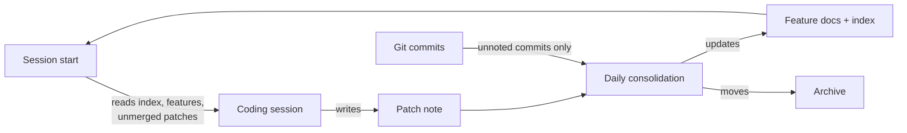

# Hippo — Handoff Spec

Sep 24, 2026 · @Sunwoo Kim

## Purpose

Build a local CLI called **Hippo** (command: `hippo`) that gives coding agents a persistent, structured memory of each project, so every session starts with context instead of from zero. This spec is written for the coding agent implementing the tool.

The memory records, per feature: its purpose, the user journey, how its DB tables, APIs and files connect, and why past changes were made. Coding sessions append short patch notes. A daily job merges those notes into the feature docs, which stay the single source of truth.

v1 scope: one person, one machine, Claude Code as the only agent. Team use comes later, so the design keeps everything as plain files that git can version.

Design principles:

- **Session agents write notes, never feature docs.** The agent that made a change knows why; it records that while fresh.
- **One consolidation process owns the feature docs.** It runs with a clean context and batches a day's changes.
- **The consolidation agent never edits code.** It writes only inside the memory directory.
- **Capture the why.** Code-derived facts can be regenerated; decisions and rejected approaches cannot.

## Core concepts

Memory works as a log plus a snapshot: patch notes are the append-only log, feature docs are the current snapshot, and consolidation folds the log into the snapshot.

| Concept | What it is | Written by | When |
| --- | --- | --- | --- |
| Feature docs | Current state of one feature: purpose, user journey, key files, DB and API connections | Init agent, then consolidation agent | On link, then daily |
| `index.md` | One line per feature, so agents load only relevant features | Init agent, then consolidation agent | On link, then daily |
| `decisions.md` | Cross-cutting architectural decisions | Consolidation agent | Daily |
| Patch notes | What changed, why, decisions, rejected approaches; never edited after writing | Session agent | End of each coding session |
| Consolidation | Merges unmerged patches into feature docs, then archives them | Daily automation | Daily |
| Git safety net | Finds commits no patch mentions and updates docs from their diffs | Daily automation | During consolidation |



Between consolidation runs the feature docs lag slightly, which is why session start also reads unmerged patches.

## Directory structure

All memory lives under one root outside the repos; each repo holds only a small dot file pointing to its UUID.

```
~/agent-memory/
  projects.json              # registry: every linked project
  prompts/
    init.md                  # first-time feature extraction
    consolidate.md           # daily merge instructions
    claude-md-block.md       # template for the ~/.claude/CLAUDE.md block
  bin/
    consolidate.sh           # called by launchd/cron
  logs/
    2026-09-24.log
  projects/
    <uuid>/
      meta.json
      index.md
      decisions.md
      features/
        auth/
          overview.md        # purpose + user journey
          technical.md       # key files, DB, API, connections
        billing/
          ...
      patches/               # unmerged session notes
        2026-09-24T143012.md
      archive/               # patches already consolidated
      needs-review.md        # files or changes no feature claims
```

Inside each linked repo:

```
<repo>/
  .hippo                     # {"uuid": "..."}; gitignored in v1
```

Machine-wide, install appends a marked Hippo block to `~/.claude/CLAUDE.md`, the user-level file Claude Code loads in every session (text in Session flow). The repo's own `CLAUDE.md` is not touched in v1.

`meta.json` fields: `uuid`, `repo_path`, `remote_url`, `default_branch`, `created_at`, `last_synced_commit`, `last_consolidated_at`. Storing `remote_url` lets a re-cloned repo be re-linked to its existing memory.

`projects.json` is a list of `{uuid, repo_path}` entries. The daily job loops over it instead of scanning the disk.

Patch filenames use a sortable timestamp with seconds, so two sessions in the same minute never collide.

## File formats

Every feature doc lists its key files, because that list powers both agent navigation and the mapping from changed files to features.

**`index.md`**, one line per feature:

```markdown
# Features
- auth: login, sessions, key rotation → features/auth/
- billing: plans, invoices, Stripe webhooks → features/billing/
```

**`features/<slug>/overview.md`**: purpose and user journey, written for someone new to the feature.

**`features/<slug>/technical.md`**:

```markdown
# Auth: technical

## Key files
- src/auth/login.ts: login handler, issues session token
- src/auth/session.ts: session middleware, used by all protected routes
- db/migrations/004_users.sql: users + sessions tables
- scripts/rotate-keys.sh: manual key rotation, run quarterly
- src/auth/oauth/**: all OAuth providers

## Data
- users, sessions tables; sessions.user_id → users.id

## API
- POST /api/login, POST /api/logout, GET /api/me

## Connections
- billing reads users.plan_id
```

Key-file rules:

- List 5 to 10 crucial files, not everything the feature touches.
- Give each a one-line role.
- Globs are allowed for folders owned entirely by one feature; new files there map automatically.
- Always include scripts (migrations, seeds, maintenance tools), since they are hard to discover from app code.

**Patch notes** (`patches/<timestamp>.md`):

```markdown
---
author: me
created_at: 2026-09-24T14:30:12
commits: [a1b2c3d, e4f5a6b]
features: [auth]
---
## Changed
Session expiry moved from 24h to 7d with sliding refresh.

## Why
Users were logged out mid-task on long sessions.

## Rejected
Refresh tokens in localStorage: XSS risk.

## Follow-ups
Add a test for refresh near expiry.
```

The `commits` field is what lets consolidation tell which commits already have notes. `author` is included now so team mode needs no format change.

## Install flow

Install is split into two commands: `hippo install` runs once per machine, and `hippo link` runs once per repo.

### `hippo install` (once per machine)

1. **Check dependencies.** Confirm `git` and `claude` are on PATH and Claude Code is logged in. Fail loudly with a fix message.
2. **Create the root** `~/agent-memory/` with `prompts/`, `bin/`, `logs/`, `projects/`, and an empty `projects.json`.
3. **Seed the prompt files:** `init.md`, `consolidate.md`, and `claude-md-block.md`.
4. **Append the Hippo block to `~/.claude/CLAUDE.md`.** It tells every Claude Code session how to read memory and how to write a patch doc after each session (full text in Session flow). Create the file if missing and never touch content outside the `<!-- hippo:start -->` / `<!-- hippo:end -->` markers. If the markers already exist, replace only what is between them, so re-installing never duplicates the block.
5. **Install `bin/consolidate.sh`** and register the daily job (see Automation).
6. **Be idempotent.** Re-running must not overwrite prompts the user has edited; offer `--force` for that.

### `hippo link` (inside a repo)

1. **Validate.** Must be inside a git repo; stop if `.hippo` already exists.
2. **Create identity.** Generate a UUID, create `projects/<uuid>/` with its subfolders, write `.hippo` into the repo root.
3. **Gitignore.** Add `.hippo` to `.gitignore` in v1.
4. **Write `meta.json`,** setting `last_synced_commit` to the current HEAD of the default branch. Without it, the first consolidation has no starting point.
5. **Register** the project in `projects.json`.
6. **Check the global block.** Confirm the Hippo block exists in `~/.claude/CLAUDE.md`; if not, tell the user to run `hippo install`.
7. **Run the init agent** headlessly with `init.md`. It reads the codebase and writes `index.md`, `features/*/overview.md`, `features/*/technical.md`, and a first `decisions.md`.
8. **Prompt the user to review** the generated docs. Print the paths and suggest fixing feature boundaries now, since every later update builds on this snapshot.

### `hippo unlink`

Remove the registry entry and the `.hippo` file, then move the memory dir to an archive location rather than deleting it. The global block stays, since it only acts in repos that contain a `.hippo` file.

## Session flow

Every normal coding session reads memory at the start and writes exactly one patch note at the end; it never edits feature docs.

**At start**, the agent reads:

1. `index.md`
2. The feature docs relevant to the task (not all of them)
3. Unmerged patches in `patches/` whose `features` overlap the task

**At end**, the agent writes one patch note in the format above, listing the commits it made and the features it touched. If nothing meaningful changed, it writes nothing.

These instructions live in one block that `hippo install` appends to `~/.claude/CLAUDE.md`, so every linked repo gets them without edits to the repo:

```markdown
<!-- hippo:start -->
## Hippo project memory
If the repo root contains a `.hippo` file, this repo is linked to Hippo.
Its memory is at ~/agent-memory/projects/<uuid>/ (uuid is in `.hippo`).

At the start of a task:
- Read index.md, the features/* relevant to the task,
  and any patches/* whose `features` overlap it.

After each session that changed code, write one patch doc:
- Path: patches/<YYYY-MM-DDTHHMMSS>.md
- Frontmatter: author, created_at, commits (hashes you made), features
- Sections: Changed, Why, Rejected, Follow-ups
- Keep it short. Skip it if nothing meaningful changed.

Never edit features/, index.md or decisions.md;
the daily Hippo job updates those.
<!-- hippo:end -->
```

The block's source text is `prompts/claude-md-block.md`, so editing that file and re-running `hippo install` updates it.

Later upgrade: move the end-of-session write into a Claude Code hook, since a hook always fires while an instruction can be forgotten. Check the current Claude Code hooks docs for the right event.

## Update flow (daily consolidation)

Once a day, for each registered project, a shell script gathers the inputs and a headless agent merges them into the feature docs.

The shell script does all git work, so the agent only needs to read and write markdown:

1. **Skip check.** If `patches/` is empty and the default branch HEAD equals `last_synced_commit`, log "no changes" and skip the project without invoking Claude.
2. **Gather commits.** Run `git log <last_synced_commit>..<default_branch>` and collect the hashes.
3. **Find unnoted commits.** Subtract every hash listed in unmerged patches' `commits` fields.
4. **Collect diffs** for the unnoted commits only (`git show --stat` plus the patch, truncated if huge).
5. **Invoke the agent** with `consolidate.md`, the unmerged patch files, and the unnoted diffs.

The consolidation agent then:

1. Folds each patch into the features it names: updates `overview.md` and `technical.md`, adds lasting decisions and rejected approaches to `decisions.md`, and updates `index.md` if features were added, renamed or split.
2. For unnoted commits, maps changed files to features through key-file lists and globs, then updates those docs with a "(changed without session notes)" marker, since the why is unknown.
3. Appends files no feature claims, and key files that no longer exist, to `needs-review.md`.

After the agent finishes, the script moves processed patches to `archive/` and updates `last_synced_commit` and `last_consolidated_at`. If the agent fails, nothing is archived and `meta.json` is unchanged, so the next run retries.

## Automation

The daily job runs locally, because it needs the local repos and memory directory.

- **Scheduler.** On macOS use a launchd agent with a calendar interval; unlike cron, it runs a missed job when the machine wakes. On Linux use cron or a systemd timer.
- **Headless Claude.** Invoke Claude Code in non-interactive print mode (`claude -p`) with the prompt and inputs. Verify current flags in the Claude Code docs before coding.
- **Permissions.** A headless run cannot ask for approval, so pre-configure allowed tools. Restrict writes to `~/agent-memory/projects/<uuid>/`. The agent needs no shell or git access, since the script supplies the git data.
- **Lock file.** Prevent overlapping runs if one takes long.
- **Logging.** One log file per day in `logs/`, recording per project: skipped, succeeded, or failed with the error.
- **Missing repos.** If `repo_path` no longer exists, log a warning and skip; don't delete memory.

## CLI and build order

The v1 CLI has six commands; build them in the order below so each step is usable before the next.

| Command | Runs where | Does |
| --- | --- | --- |
| `hippo install` | Anywhere | One-time machine setup, including the `~/.claude/CLAUDE.md` block |
| `hippo link` | Inside a repo | Connects the repo and runs init |
| `hippo unlink` | Inside a repo | Disconnects, archives memory |
| `hippo sync` | Inside a repo, or `--all` | Runs consolidation now, same code path as the daily job |
| `hippo status` | Anywhere | Per project: last sync time, unmerged patch count, needs-review count |
| `hippo open` | Inside a repo | Prints or opens the project's memory dir |

Build order:

1. `install` (root, prompts, registry, global `CLAUDE.md` block) and `link` with the init agent
2. Test a few real sessions and check that patch docs get written
3. `sync` with patch consolidation only
4. The git safety net for unnoted commits
5. The scheduler, `status` and `unlink`
6. The session-end hook

### Later: team mode

No v1 work is needed beyond keeping `author` in patches. When the time comes: the memory dir becomes its own git repo (or moves into the project repo), `.hippo` gets committed, the Hippo block moves into each repo's committed `CLAUDE.md` so teammates get it without running install, consolidation runs in CI on merges to main and opens a PR for human review, and patches stay one file per session to avoid merge conflicts.

## Name

The tool is **Hippo**, after the hippocampus, the part of the brain that consolidates short-term experience into long-term memory, just as the daily job turns patch docs into feature docs.

- CLI command: `hippo`
- Repo dot file: `.hippo`
- `CLAUDE.md` markers: `<!-- hippo:start -->` / `<!-- hippo:end -->`

Before publishing, check that `hippo` isn't already taken on PATH or in your package manager.
